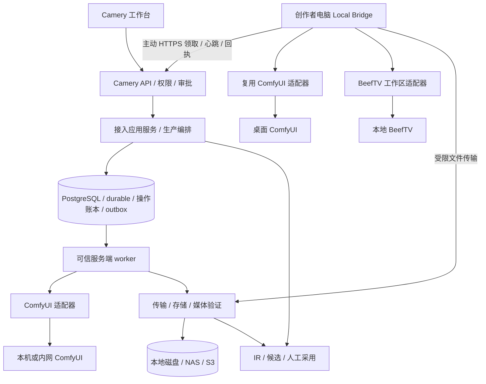
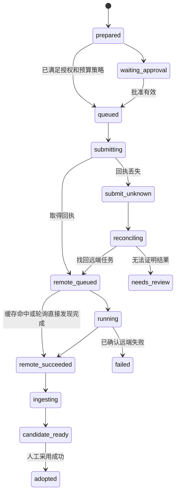

# 本地 ComfyUI 与 BeefTV 接入方案

日期：2026-11-11。版本：1.1。状态：**实施规格已整理，等待所需前置能力完成后分批纳入执行；尚未实现或完成真实生成验收**。

依据：[当前实施计划](implementation_plan_v2.md)、[产品方案](../product/solution_v2.md)、仓库代码，以及本次只读发现的 BeefTV 工具契约与 ComfyUI 官方协议。本文将用户所说的 Comfy 理解为 ComfyUI；“本地”同时覆盖应用服务器所在内网与创作者自己的电脑。

## 0. 实施入口与文档职责

本方案按“先完成设计，前置就绪后再实施”准备。本轮只完善实施材料，不启动新的接入代码、数据库迁移、设备配对或外部生成，也不改变当前前置工作的执行顺序。

| 文档 | 负责的决定 | 实施时如何使用 |
|---|---|---|
| 本文 | 产品边界、三方职责、部署形态、能力与风险 | 先确定交付切片及本次不包含的范围 |
| [接口与持久化契约](local-integration-contracts.md) | 字段、状态转换、端口、API、错误、事务、设备/文件协议 | 按契约编写 schema、应用服务和契约测试；具体字段与状态以该文档为准 |
| [可执行任务与接入清单](local-integration-backlog.md) | 前置能力门、LIN 任务、责任文件、TDD、验收证据、排期去重 | 逐项填入真实前置证据后激活就绪任务；任务依赖和估算以该文档为准 |
| [主实施计划 1.4](implementation_plan_v2.md#14-本地-comfyui-与-beeftv-接入增补2026-11-11) | 与现有 T0/T2/T3/T4 任务的归属关系 | 保留 LIN 子任务身份，避免把同一存储、API 或队列工作重复排期 |

下文的数据表和状态图是架构摘要，不是第二套字段规范。详细契约变化先更新契约和对应测试/任务，再同步摘要；未验证的 BeefTV 传输与上传字段必须通过 L0 的证据任务确定，不能用猜测填满接口。

“可直接实现”指开发者能够按任务卡进入实现，不需要重做模块划分或补写验收条件；不表示未提供的实机、模型、凭据或供应商字段已经可用。缺少某项证据只阻塞依赖它的实现/发布切片，不能以模拟器通过替代真实验收。

## 1. 结论与交付范围

新增“本地运行环境与外部制作工作区接入”能力，分为两条链路：

- **ComfyUI 生成执行**：复用 `model-modes`，补齐环境预检、参考素材上传、持久化提交对账、资源限制、流式产物归档。
- **BeefTV 制作协作**：新增工作区适配器，连接分镜、画布、素材、任务、时间线与工程交接；同步回来的内容进入 Camery 候选。

Camery 仍负责项目权限、分镜 IR、版本、任务编排、预算与正式采用。ComfyUI 负责工作流执行。BeefTV 是可编辑的外部制作工作区；它的生成渠道是另一个可选执行后端。三者各有明确主责，不共享数据库，也不通过桌面 UI 自动点击执行生产任务。

每次生成只选择一个实际执行所有者：Camery 直发 ComfyUI，或委托 BeefTV 的生成渠道。经 ComfyUI 生成后向 BeefTV 上传/绑定素材不再触发生成；BeefTV 渠道内部若使用 ComfyUI，也只记录为该次委托的执行链，不另发第二份任务。

首个闭环：**Camery 分镜 → 本地 ComfyUI 出图 → 校验归档为素材候选 → 人工采用 → 推送 BeefTV 画布 → 外部编辑 → 显式拉回差异候选**。之后扩展视频、预览时间线、多机器及 BeefTV 生成。复杂剪辑、调色、混音继续交给现有后期软件，遵守 ADR-010、017。

### 1.1 已验证与未知

| 项目 | 本次核实结果 | 不应推导出的结论 |
|---|---|---|
| Camery ComfyUI 库 | 已有 API 模板编译、提交、history/queue 查询、下载、健康查询、WS 重连 | 已接入业务服务或已经真实出图 |
| 持久化与版本内核 | 有 PG 租约、步骤日志、未知结果对账、候选与采用、预算/RBAC 核心 | 这些模块已经覆盖桌面桥接和外部画布同步 |
| Camery server | 有认证 API 骨架、固定章节 worker | 已有生成、连接管理、素材、候选审阅 HTTP API |
| 存储、媒体处理、前端 SSE | ADR 与计划已有设计；接入需要相应实现 | 现成可用的大文件素材服务或完整工作台 |
| BeefTV 能力发现 | 本会话能发现画布、分镜、素材绑定、任务、模型目录、生成提议/提交、时间线更新/渲染和工程 ZIP 工具；业务目录返回资源上传/分片/完成和按 operation 查询任务等入口 | Camery 进程已获得这些工具的传输、凭据或同等权限；写入、上传和渲染已成功 |
| ComfyUI 上游协议 | 已查官方路由、消息文档及当前上游源码 | 用户本机安装版本一定具备上游最新能力 |
| 实机环境 | 本次未连接 ComfyUI 测试节点，未查询用户画布正文、未提交生成或改变 BeefTV 工作区 | 已知 GPU、模型、工作流、BeefTV 版本与部署端口 |

代码核实入口：[`model-modes/README`](../../packages/model-modes/README.md)、[`comfy.ts`](../../packages/model-modes/src/connectors/comfy.ts)、[`comfy-session.ts`](../../packages/model-modes/src/connectors/comfy-session.ts)、[`server/README`](../../packages/server/README.md)、[`durable/types.ts`](../../packages/durable/src/types.ts)。本次是代码与契约审阅，没有重新运行既有测试。

## 2. 架构与部署

### 2.1 两种执行位置，共用业务语义

| 形态 | 部署与调用 | 适用情况 |
|---|---|---|
| 服务端直连 | 私有化 API/worker → 管理员注册的内网 ComfyUI；worker 使用现有 PG 执行核心 | ComfyUI 对应用服务器可达，优先落地 |
| 桌面桥接 | Bridge 与 BeefTV/ComfyUI 同机，主动连接 Camery API，领取明确授权的任务 | BeefTV 位于 Windows 创作者电脑，或 ComfyUI 仅监听桌面回环地址 |

同机可将 Bridge 与服务端部署在同一主机，但协议边界保留。Bridge 是受限执行宿主，不是第二个制片 Agent，也不直接连 PG、运行数据库迁移或持有管理员凭据。共享 `model-modes` 和接入契约，业务调度权仍在服务端。

容器中的 `127.0.0.1` 指容器自身。若 ComfyUI 只绑定宿主回环，优先在宿主运行 Bridge；宿主网关只有在实际可达并受防火墙限制时才采用。不能把 `host.docker.internal` 当作所有系统均支持的固定方案。

BeefTV 桌面运行时的传输方式、启动参数、鉴权和工作区身份须在 L0 验证。当前工具名称不是已经可复制到 Camery 的 SDK。优先使用受支持的 MCP/CLI 接口；若其提供稳定且获授权的本地 HTTP 接口，可由同一适配器封装。禁止猜端口、读取桌面内部数据库或绕过其权限。

### 2.2 本地与离线的定义

本地 Bridge/BeefTV 不代表模型在本地执行。每个能力声明 `executionLocation=local|lan|cloud`、是否联网及费用类型；BeefTV 远端模型渠道需要单独启用。私有化离线模式只路由到验证过的离线能力，阻止云端渠道和远程审片；不静默回退到云模型。

Bridge 离线时不领取新任务。已发往本地引擎的任务可能继续执行，回执和产物暂存，联网后先对账。服务端显示“设备离线/执行结果待确认”，不显示成失败或自动转移到另一机器。Camery API 不可达时，用户仍可独立使用 BeefTV，但这些修改需要恢复连接后显式导入候选。

## 3. 模块与依赖划分

| 位置 | 本次新增/扩展职责 | 依赖规则 |
|---|---|---|
| `packages/model-modes`（已有） | Comfy 输入 staging、依赖预检、版本能力档案、模式专属输出解析、定向取消适配 | 继续只负责模型协议，不写正式 IR、不管理画布同步 |
| `packages/integrations`（拟新增） | 连接/设备能力、操作账本、外部绑定、同步计划、BeefTV adapter、统一错误与回执 | 应用层组合 access、versioning、durable、model-modes；协议 adapter 不反向依赖 server |
| `packages/local-bridge`（拟新增） | 固定端点适配器宿主、出站通信、心跳、持久化回执暂存、文件 staging | 依赖共享契约与适配器；不包含 PG store、全局预算和正式采用权限 |
| `packages/server`（已有） | 连接管理/设备配对/生成/同步 API；装配新 worker 角色 | 保持默认拒绝的 guard；不扩展现有章节 worker 为任意执行器 |
| `production`（既定计划模块） | 生成业务任务、模式 pin、GPU 配额、重试策略、迟到结果 | 初期可放在现有应用服务中；按业务边界抽出，不先堆空包 |
| 存储边界与 `media-py`（既定计划） | 流式上传下载、临时文件、哈希、探测、素材可用性；FFmpeg | 正式素材归档的共享能力，不在两个 adapter 各写一套 |
| `ir` / `versioning` / `timeline`（已有） | 保持正式模型、候选采用和精确时间代数 | 外部系统 ID 放绑定表，不塞进通用 IR |

内部工具经过应用服务暴露 `generation.prepare/submit/status/cancel-request`、`workspace.preview-sync/apply-sync/pull-candidate`、`asset.import` 等窄接口。命名为拟议内部能力，不是当前可调用的 MCP 工具。模型不能使用通用 `business.call` 或任意 HTTP 地址绕开角色权限。

BeefTV 的文档同步不加入现有 `openai | comfyui | fal` 模型连接器枚举。后续如启用 BeefTV 生成，只为生成子能力增加明确的 provider adapter；画布、时间线仍由 workspace adapter 管理。

## 4. 数据契约与权威来源

以下是拟议持久化记录，不是要求新增八套独立服务。所有业务查询携带服务端验证的 `tenantId/projectId`；ID 不能由客户端提供后直接视为授权。

| 记录 | 关键字段 | 约束 |
|---|---|---|
| `IntegrationConnection` | id、provider、执行位置、deviceId、endpointRef、credentialRef、workspaceIdentity、capabilityDigest、启用状态 | 端点由管理员登记；凭据不放普通配置或 IR |
| `LocalDevice` | id、租户、允许项目、设备公钥/凭据引用、版本、协议版本、lastSeen、撤销时间 | 设备令牌只授予自己的领取、回执和对象传输 |
| `ExternalOperation` | operationId、taskId、provider、connectionId、requestDigest、执行状态、remoteId、原 clientId、attempt、lease/fence、证据与时间戳 | 同租户/连接/operationId 唯一；相同 ID 不同内容返回冲突 |
| `GenerationJob` | sourceVersion、modePin、workflowDigest、environmentDigest、输入素材版本、seed、执行连接、预算预留、approvalRef | 提交后冻结；新 seed/模式/内容是新的显式生成尝试 |
| `WorkspaceBinding` | Camery 对象ID/版本、BeefTV workspace/canvas/node/row/resource/asset ID、上次共同版本、外部 revision、字段摘要 | 不能靠标题/镜号推断身份；多个对象关系单独建映射 |
| `SyncRun` | 方向、源快照、基线、差异、冲突、每步 operationId、回执、映射检查点 | 失败可从检查点继续；不声称跨系统 ACID |
| `ArtifactReceipt` | 来源 operation、输出槽位、SHA-256、字节数、媒体探测、存储引用、原文件名、原始来源 | 相同来源/槽位只归档一次；不同候选可引用相同字节 |
| 接入 outbox/审计（拟新增） | 任务提交、变更候选、进度与回执事件 | 复用现有协作 outbox 的事务模式，新增接入专属记录/投递适配；现有 outbox 不是通用接入总线 |

IR 仍使用已有 `Segment`、`ShotTake`、`MediaAsset`。BeefTV 的一行分镜是展示投影，不等于一个 Segment 或一次模型生成；一个 Segment 可以服务多个 ShotTake。生成以锁定的 Segment/素材意图为单位，投影到多个节点不重复生成或扣费。

`WorkspaceBinding` 记录外部身份、同步基线与精度损失；`MediaAsset` 的 `file.path/sha256/mime_type` 必须对应 Camery 可解析、实际存在且通过校验的文件。BeefTV URL、资源 ID、浏览器 `blob:` 地址或另一台机器的绝对路径不能直接标记为 ready。

### 4.1 冻结与审计内容

一次提交至少冻结：项目/来源版本、模式版本与 digest、API workflow 原文摘要、参数与 seed、引用素材身份/哈希、Comfy 节点/模型环境清单或 BeefTV 模型配置 revision、执行连接、预算和用户批准范围。敏感提示正文按项目权限保存，日志只存摘要与安全错误码。

费用分别记录供应商货币费用和本地 GPU 用时/资源配额。本地生成可无供应商费用，但不等于无资源成本。未知结果保留预算占用；真实量未知不能结算为 0。BeefTV 报价缺失时显示未知并阻止自动收费提交；不拿 Comfy GPU 估算替代 BeefTV 账单。

## 5. 执行状态、幂等和恢复

### 5.1 业务状态与 durable 状态分离

该图是生成业务投影，未画出所有失败/取消路径。保留现有 durable `queued/running/waiting/reconciling/succeeded/failed/cancelled`；不把上述每个状态加入通用 TaskStatus。生成工作流到 `candidate_ready` 可结束，人工采用由版本域单独处理，不长期占住执行租约。

远端提交属于 durable `external` 步骤，即使它发生在本机也不能标记为可回放的纯计算。当前 runtime 对 external 抛错统一进入 unknown/reconciling，并没有自动按 `ModelError.outcome` 分类重试：应用适配器需把可证明的 `not_sent/rejected` 返回为结构化步骤结果，由业务策略决定后续尝试；真正未知保留对账状态。一个 workflow 的步骤按顺序执行；并行生成拆为多个子任务，由生产调度限制并发。

### 5.2 提交规则

1. API 在接入模块的一个 PG 事务中冻结生成请求、创建操作意图和 integration outbox。relay 按稳定任务身份幂等 enqueue durable；此时还不能派发远端生成。workflow 的首个幂等预算步骤在 durable task 已存在后调用现有预算分配，取得有效 held 回执，再核验批准/权限、进入可提交队列。预算不足停在等待状态，不消耗 GPU 或收费。现有各 store 自带事务，不能把连续调用描述为跨包原子事务；上述顺序采用可恢复的分步执行。
2. 外部调用前持久化“即将提交”的状态；Bridge 派发也必须晚于预算/授权通过，领取携带 operationId、摘要、租约 fence、权限范围与有效期，Bridge 本地另保存可恢复日志。相同 operationId、相同内容重放应返回已有回执；不同内容必须拒绝。
3. 返回成功后保存 remoteId，再继续监听。`client_id`、HTTP requestId、追踪 traceId 均不自动提供供应商幂等。
4. 网络错误区分 `not_sent`、`rejected`、`unknown`。只对可证明未发送的请求安全重试；已经发送但回执未知，先对账。
5. Comfy 以 promptId 或提交前关联标记查询 queue/history；BeefTV 生成以 `tasks/by-operation/:operationId` 查原任务。查询不到不证明没执行，特别是远端重启/历史清理之后。
6. 长期无法确认进入 `needs_review`，展示证据、可能占用和“继续查找/接受风险后新建尝试”。重新生成使用新的 operationId，并关联旧尝试；禁止静默重提。

**不承诺通用 exactly-once。** PG 唯一约束只能确保本地操作记录唯一；outbox 至少一次投递、远端幂等能力与未知状态处理共同减少重复副作用。Bridge 写日志与远端接受请求之间仍存在崩溃窗口，需要恢复对账。

### 5.3 多进程与离线

fence 用于拒绝过期 worker 的业务更新，不会撤销旧 Bridge 已发送的 GPU/收费请求。设备失联或租约过期后，同一操作不自动迁移到另一连接重提；新的宿主只接管查询/对账。设备恢复先上报旧回执，服务端核对操作归属和摘要，再决定接纳为正常或迟到结果。

Bridge 只保留受权限保护的追加日志/检查点和素材暂存，不引入第二套调度数据库。日志写入需可恢复、原子检查点和磁盘配额；重复消息按 operationId+步骤身份去重。凭据与日志分开保存。过期执行令牌拒绝新的副作用，正在远端执行的任务按真实状态处理。

### 5.4 取消与迟到结果

UI 和账本分开表示 `cancel_requested`、`remote_cancel_confirmed`、`monitoring_stopped`。取消本地等待不等于 GPU 已停止，HTTP 200 也不直接证明生成终止。取消后仍收集任务终态及费用证据；迟到产物归档但不自动采用，不丢弃预算记录。

新建独立的对账任务可在原 durable task 被取消后继续追踪远端结果；不能依赖已经终止的工作流继续执行回收步骤。旧 worker 回执不能复活已取消任务，只能作为经验证的对账证据。

## 6. ComfyUI 详细接入

### 6.1 能力预检与模式包

按连接保存安装版本、GPU/驱动信息、所需节点列表、custom node 版本、模型文件身份和工作流 digest。预检先判断可达，再判断依赖，最后以真实模板完成小样验收；`/system_stats` 有响应只说明可达。

模式包补充 `inputBindings`、`outputBindings`、所需节点/模型、支持的尺寸/帧率/时长、输入输出上限、预估资源、真实验收证据。只使用 API 格式 workflow；UI 工作流 JSON 不直接当 `/prompt` 入参。只改已声明槽位，不允许用户字符串执行脚本或临时安装 custom node。

模型/节点安装由管理员维护环境；失败明确报告缺项。大模型摘要可在安装时计算并缓存，记录验证时间，不要求每次生成重新读取全部模型权重。

### 6.2 协议与现有代码差距

| 环节 | 方案 | 当前差距 |
|---|---|---|
| 发现 | `/system_stats`、所需 `/object_info/{node_class}`，必要时模型列表 | 当前主要是健康可达性 |
| 输入 | 图像使用受限 multipart 上传，拿返回文件名/子目录再编译 workflow；音视频按模式验证过的输入方式 staging | 当前 transport 的 body 只有 JSON，无上传；不假定 `/upload/image` 通用于音视频 |
| 提交 | `/prompt`；记录真实返回 promptId、clientId 和请求摘要 | 需操作账本与对账；当前 clientId 不是幂等键 |
| 进度 | 复用 WS watch，按 promptId 过滤；断线回查 history/queue | watch 是进程内能力，宿主需恢复订阅 |
| 结果 | 用模式声明解析输出槽位，确认 history 终态后取文件 | 当前只扫描 `images/gifs/audio`，不保证所有视频节点输出结构兼容 |
| 下载 | 独立流式传输层，用 `/view` 等经模式验证的定位方式 | 当前全量缓冲/base64，默认 4 MiB、最高 64 MiB，不适合作为视频通道 |
| 取消 | 对部署版本确认支持的定向取消做 adapter；旧版按任务移除 pending，running 无安全能力则保留取消请求 | 当前 connector 没有远端取消方法 |

端点与 WS 语义依据 [ComfyUI 官方路由](https://docs.comfy.org/development/comfyui-server/comms_routes) 和 [官方消息文档](https://docs.comfy.org/development/comfyui-server/comms_messages)。WS 的执行成功/节点输出只是触发查询的信号，不直接变成 Camery ready 素材。

2026-11-11 查阅的 [上游 server.py](https://github.com/Comfy-Org/ComfyUI/blob/master/server.py) 已有自定义 `prompt_id` 和 `/api/jobs/{job_id}/cancel`，后者使用按运行任务匹配的中断逻辑。**这不是用户安装版本的保证**：须锁定具体版本/commit、做能力与并发测试后启用。预先分配 promptId 有助于对账，不证明重复提交同 ID 会被去重。无参数全局 `/interrupt` 和全局清队列不用于共享节点的单任务取消。

### 6.3 GPU 调度与重试

MVP 每个 Comfy 实例限制一个 Camery 在途生成，设置待排队上限；若用户在同实例手动排队，健康页显示外部占用，不清除外部任务。不使用自报剩余显存作为唯一可运行判据。

第二阶段按物理 GPU/resourceGroup 建资源租约，避免两个 Comfy 实例共用 GPU 却各自满并发。以模式需求、环境匹配、公平配额和排队时间选择连接；模型热加载亲和性是优化项。工作流提交后禁止迁移，只有确认未提交的任务可以重新调度。

OOM、缺节点、模型错误、磁盘满、超时、用户取消分别分类。缺依赖不自动重试；OOM 暂停对应模式/连接并提示调整，不能擅自换分辨率或 seed。纯查询重试与新生成尝试分开，连续故障熔断阈值可配置。

## 7. BeefTV 详细接入

### 7.1 传输与能力档案

首次接入需记录应用版本、传输类型、协议/工具 schema 摘要、当前工作区身份、模型配置版本、权限和可用操作。只配置受支持的可执行文件/端点，CLI 使用固定命令与参数数组，不拼 shell 命令。只传必要环境变量，限制启动路径和文件范围。

优先使用专门的 canvas/asset/task 工具；底层 business 接口只在专门工具缺失时由受信 adapter 按固定 allowlist 调用。业务目录中部分上传/素材接口的 body 只有宽泛结构，必须取得实际参数契约并用测试工作区验收后才能发布；不得臆造字段。

### 7.2 功能矩阵

| 产品动作 | 已发现的 BeefTV 能力 | 实施边界 |
|---|---|---|
| 选定工作区/画布 | `canvas.search/get`，项目/画布目录 | 首次由用户选定；跨工作区不自动迁移映射 |
| 创建分镜草稿 | `canvas.create`、`canvas.script.prepare` | 保存 Camery 对象与返回 row/node ID 映射；不启动生成 |
| 同步局部修改 | `canvas.script.row.update`、`canvas.node.update/configure` | 只更新允许字段；保留用户独立编辑 |
| 导入 Comfy 产物 | resources 分片上传/complete，素材业务入口，`canvas.node.bind_asset` | 上传、建素材、绑定是多个步骤；真实写链路待验证 |
| 从 BeefTV 导入 | `asset.get/list`、`task.get`、resources 文件接口 | 下载原文件并重新校验；外部路径不作为就绪证明 |
| 可选 BeefTV 生成 | `model.catalog` → `canvas.generation.propose` → `submit` → `task.get`/按 operation 查询 | 先准备并核对冻结参数/报价；用户批准后提交；结果未知查原任务 |
| 时间线/预览 | `canvas.timeline.update/render`，`media.overview/inspect/check` | 时间线 v2 毫秒；可见 video/image 不可重叠；预览成功不等于正式交付通过 |
| 工程交接 | `canvas.project.export` | 工具声明可导出 ZIP；实际可编辑性/打开验证单独验收；未证实通用 ZIP 导入能力 |

以上能力来自本次连接器 schema 与 `business.list` 只读发现，未执行写入。收费生成与本地时间线渲染分别记录，不能把“BeefTV 在本地”当成其所有操作免费或离线。

### 7.3 分镜与素材映射

| Camery | BeefTV 投影 | 回流处理 |
|---|---|---|
| Project / Episode | 项目/画布绑定，可按集建立画布 | 保留独立外部 ID，不按名称自动认领 |
| Shot / 台词快照 | 分镜行的剧情、对白、计划时长 | 变更生成 ChangeSet；锁定台词需走解锁/审阅流程 |
| 首帧、角色参考、视频意图 | 相应媒体节点与草稿参数 | 草稿与现有成品分开；不把草稿写成正式采用 |
| Segment / MediaAsset 版本 | 素材库 asset/resource 与节点绑定 | 检查原件、实测时长和来源，创建素材候选 |
| 已采用 ShotTake | 只导出支持范围的预览 clip | 原精确 source 区间、变速与版本保存在映射基线 |

首版“一集一画布”为默认组织方式，可人工选择已有画布。共享素材按身份/哈希复用，多个镜头节点可引用同一素材；不以一行分镜必配一次生成的方式破坏多对多模型。

### 7.4 同步一致性与冲突

采用**显式推送、显式拉取、三方差异比较**：共同基线 B、Camery 当前 C、BeefTV 当前 E。首版不后台实时双向改写。

- C 改、E 未改：可推送；E 改、C 未改：形成导入候选。
- 双方修改不同字段：可生成合并建议，写入前仍检查远端 revision。
- 同字段修改、对象删除、绑定媒体变化、锁定内容变化：进入冲突列表，由用户选取；不按时间戳最后写入覆盖。
- 外部删除不级联删除 Camery；Camery 删除也不默认清除用户 BeefTV 节点。记录解绑/缺失，单独确认清理范围。

每次写前读 revision，按画布串行提交。多步骤同步使用 saga：创建画布、建行、上传、建素材、绑定各有独立稳定 operationId、摘要与回执。写成功即保存返回 revision 和 ID 映射；中途失败保留已完成步骤，仅继续剩余步骤。

结果未知重试时复用**同一 operationId、同一请求体、同一 expectedRevision**，先查回执/任务，不能为了绕过冲突换 ID 重发。若确认 revision 冲突且原操作未生效，重新读取、生成新计划，并使用新的 operationId。复用原 ID 携带不同请求是错误。

只对专门工具支持的字段做最小 patch。虽然存在整图 commit，首版不用于自动同步；画布整体 revision 冲突不意味着允许覆盖无关节点。回流候选的采用再次检查 Camery base version、锁和权限。

### 7.5 时间线精度与能力损失

Camery 使用有理数时间/帧信息，BeefTV 公开时间线使用整数毫秒，不能宣称往返无损。转换统一计算每个精确边界再量化；不能逐段时长四舍五入后相加造成累积漂移。

保存每个 clip 的原精确区间、量化后区间、取整策略、误差和映射版本；未改的外部片段回流时使用原基线值。被改过的毫秒时间作为新候选，展示误差并重新做覆盖/同步检查。输出零时长、非法区间或不符合整帧要求时拒绝转换。

变速、可见视频重叠、复杂转场、独立声音策略或通道效果超出已验证能力时，明确列出不支持项。用户可选择导出预渲染预览并保留原时间线，或使用既有后期交接格式；不能悄悄丢弃信息。L3 时间线功能首版只支持可表达的非重叠画面、音频、文本字幕子集；L0–L2 的 MVP 不包含时间线交付。

## 8. 素材传输与归档

统一链路：授权的输入源 → 临时文件/分片 → 大小/哈希 → 媒体探测 → 原子发布 → 素材记录 → 候选。文件先落到 staging，校验全部通过才发布为可用；不能在下载开始时写 ready。

新增 `BinaryTransfer` 边界，与小 JSON 请求分开，复用端点白名单、DNS/重定向限制、超时和取消策略。支持流式读写、背压、并发与磁盘配额，不把完整视频转 base64 存进 PG、步骤日志或 MCP JSON。

- 网络方案：Bridge 经认证会话取特定输入对象、上传指定任务输出；远端对象存储可提供短期、单对象、单方法授权。下载地址必须经来源规则验证，不接受模型返回的任意 URL。
- 同机方案：只读授权 staging/input 目录并写入指定 output 目录；校验解析后的路径边界、符号链接、Windows reparse point 和读取期变化。任意绝对路径不属于协议能力。
- NAS 方案：可共享介质，仍以素材身份/哈希与挂载映射解释文件，不传播某台电脑盘符。
- 断点续传：仅对确认支持分片/Range 且内容版本稳定的服务启用；否则删除本任务未完成临时文件并重新下载，不重新生成。

媒体探测记录实际宽高、编码、帧率、时长、音轨、采样率；验证输出数量与模式声明。文件哈希和 ffprobe 不替代画面/声音质量审查。可选 BeefTV `media.inspect/check` 需要先取得媒体 version；付费 `media.review` 不自动开启。

重复传输按来源操作+输出槽位去重，字节存储可内容寻址；删除只回收无引用且超过保留期的本任务临时对象。存储成功但数据库事务失败时保留 orphan 标记，由重试/回收器处理，不假装跨文件系统与 PG 原子提交。

## 9. API、权限与界面

以下路由是建议，不是当前已经存在的 server 接口：

| API 族 | 用途 | 权限/副作用 |
|---|---|---|
| `POST /api/v1/projects/:projectId/integration-connections`、`.../:id/probe` | 登记连接与只读检查 | 项目管理员；probe 不生成、不安装模型 |
| `POST /api/v1/projects/:projectId/local-device-pairings`、项目内设备 revoke | 创建短期配对、批准申请、撤销设备 | 项目管理员；设备绑定租户/项目，不继承人类全权 |
| `POST /api/v1/local-devices/:id/claim`、`.../heartbeat`、`.../receipts` | 出站领取、心跳和回执 | 设备身份、明确 operation 和租约；不能任意代填 taskId |
| 设备 dispatch 的 `authorize`、`consume` 与授权查询 | 领取后核验当前资格，再确认唯一执行许可 | 绑定设备、启动实例、fence、请求摘要；领取不等于允许执行 |
| `POST /api/v1/projects/:projectId/generations/prepare`、`.../submit` | 固定参数、预算、批准后入队 | 生成权限；冻结参数摘要与授权期限 |
| `GET .../generations/:id`、`POST .../:id/cancel-request` | 查询、请求取消 | 本项目权限；返回取消证据而非假终态 |
| `POST .../workspace-sync/preview`、`.../apply`、`.../pull` | 差异预览、推送、导入候选 | 项目编辑与外部写入范围；pull 不自动采用 |
| `GET .../events?after=cursor` | 工作台任务/同步增量 | 项目授权、脱敏、断线续读；失效游标要求重取快照 |
| 素材上传会话/完成接口 | 传输字节和确认归档 | 每对象授权、限额、校验；不整体放宽 JSON body 限制 |

生成、同步、导入等长任务 API 只入队并返回操作 ID，由 durable/worker 执行；普通 GET、受限 probe、心跳、回执确认直接返回对应结果。新权限需要加入 access 的显式权限映射并测试默认拒绝；不能假定已有同名权限。设备协议不接受浏览器 Cookie/任意租户头代替认证。SSE 是拟新增的应用投影，Comfy WS 不直接暴露给浏览器。

用户界面最少包含：

1. **连接与设备**：执行位置、在线状态、模式兼容性、版本、工作区、费用类型、最近验证时间；区分可达和可生产。
2. **生成任务**：选择模式与连接、引用素材、预算、进度、取消状态、失败原因、未知结果处理、产物审阅。
3. **BeefTV 协作**：选择目标画布、推送预览、同步状态、冲突处理、拉回候选、打开外部工作区；仅使用已验证的打开入口。
4. **素材与采用**：原件/候选/当前采用、来源任务、实际参数、影响镜头、版本差异与恢复入口。

收费生成须绑定批准的项目、节点集合、参数摘要、报价/货币、模型配置 revision 和有效期。价格或参数变化重新出提议；已有明确且覆盖该操作的批准可复用，不能每次轮询再打断用户。审批令牌不能用于任意 business 接口。

## 10. 安全、运维和兼容

- 延续默认拒绝私网/明文 HTTP 的网络策略，只对管理员登记的本地连接精确放行；Bridge 端也核验端点、允许路径与文件目录。禁止任意 URL、系统命令、模型安装命令和无限重定向。
- Bridge 默认仅出站；若适配器必须本地监听，绑定回环、校验本机认证与 Origin，不公开到局域网。跨机器链路用 HTTPS，凭据用 OS 保护存储或受限 secret 文件；不写入画布和模型提示。
- 服务端每次领取/续租/回执重新核验设备撤销与项目范围。撤销后旧凭据不能使用正常接口，也不再派发；已经远端执行的任务只能尽力取消并审计，不能保证立即停止。需要回收旧证据时，由管理员重新配对或显式导入原日志/产物，核验租户、原 operation、摘要和文件完整性后作为待验证对账证据；不能因此复活任务或恢复原执行权限。
- 多租户不能依赖单个 ComfyUI 的 clientId 隔离。默认私有化每租户独立连接/输出目录；共享 GPU 时仍隔离进程、凭据、队列归属和文件权限。
- 保留健康、ready、队列长度、失联时长、未知提交数、同步冲突率、归档吞吐/失败、GPU OOM、预算未结算等指标。trace 关联 task/operation/device/remoteId；日志不记录密钥和素材正文。
- Bridge/adapter/API 协议进行版本握手。更新需排空新派发、保留在途旧 pin 与解析能力；缺少旧模式/协议时暂停并报告，不用新版本隐式恢复旧任务。
- 备份 PG、已采用及候选素材、绑定基线、模式包与环境清单。Bridge 暂存不作为唯一长期副本；磁盘满时停止新领取，保留可恢复证据。诊断包脱敏并由用户控制导出。

配置项分三类：服务端连接配置、Bridge 本机端点/目录白名单、模式环境清单。示例默认心跳 15 秒、45 秒标记失联、每实例并发 1 可用于 L0 调试，但都属于待压测参数，不是性能承诺；失联阈值不触发重提。

## 11. 实施顺序与工作量

具体任务、前置能力、文件责任、TDD 场景、验收编号与逐项估算以[可执行任务清单](local-integration-backlog.md)为准。本节只保留阶段摘要，避免两套排期口径。人员角色为后端/集成、媒体、前端、测试/运维，可由同一人兼任；人日不等于自然周，外部环境等待单独记录。

| 阶段 | 工作项与现有任务关系 | 出口条件 |
|---|---|---|
| L0 接口尖峰 | 获取真实 Comfy 版本/模板；验证 BeefTV 独立运行时传输、鉴权、schema、资源上传→素材绑定；对应 T0.7 补验收 | 锁定兼容矩阵，测试工作区可完整走一次读写/文件链路；明确未知项 |
| L1 Comfy 单机闭环 | 操作账本/outbox、预检、图像上传、真实出图、未知结果对账、流式归档；对应 T3.6/T3.7 与存储/media 前置 | 一个真实图像模式从 Camery 到候选、采用通过；崩溃不盲重提 |
| L2 BeefTV 工作区闭环 | 设备桥接、配对、单画布分镜/素材推送、ID/版本映射、显式拉回候选、冲突 UI；关联 T2.12/T3.7 | 三镜头跨系统闭环，手改不覆盖，离线回执可恢复 |
| L3 视频和交付 | 实际视频模式、参考音视频 staging、大文件、受限时间线映射、工程/预览输出；关联 T0.13/T4.1 | 黄金样例音画/区间正确，支持项与损失报告明确 |
| L4 生产加固 | 多设备/GPU资源组、公平排队、取消版本矩阵、撤销/升级/恢复、可选 BeefTV 收费生成 | 故障矩阵、权限隔离、预算与部署验收完成 |

MVP 完成 L0–L2。旧稿 25–38 / 41–62 人日及 5–8 周属于架构粗估，已由任务级估算取代，不再作为实施承诺；共享能力缺口、接入增量和可选收费渠道分别计量。先做单实例、一个图像模式、一个画布；不在 MVP 建通用插件市场、GPU 集群自动安装或全量实时双向同步。

L0 协议尖峰、契约/模拟器、共享存储/media/API 可以在各自前置就绪后并行；L1 真实闭环必须汇合所需证据，再进入 L2 工作区闭环和 L3 视频交付。设备配对可与 L1 并行；多GPU和付费渠道在基础对账稳定后做。具体任务依赖以任务清单为准，不能要求 L1 等待其本身参与实现的整个 T3.7，也不能把新增规格记为已有功能完成。

## 12. 测试与验收

先写有意义的契约与失败测试，再实现；沿用仓库脚本和现有覆盖率门槛。纯文档改动不触发完整代码测试；实施时执行受影响包检查，并在跨域里程碑运行 `pnpm check` 和必要真实 PG/部署验收。

| 层次 | 必验场景 | 通过依据 |
|---|---|---|
| 单元/属性 | 模式槽位、输出解析、状态映射、请求摘要、三方差异、时间量化、目录约束 | 确定性结果；不以“调用返回成功”代替验证 |
| 协议契约 | Comfy HTTP/WS、BeefTV schema 与错误、上传分片、revision、重复 operation | 合成回放和协议模拟器覆盖正反路径，标记 synthetic |
| PG 集成 | 双 worker 争抢、预算预留、outbox 重放、过期 fence、重复回执、采用冲突 | 唯一副作用记录、事务一致性、权限拒绝 |
| 进程故障 | 发出前/远端已收但回执丢失/保存回执前崩溃；断网；Bridge 失联；Comfy 重启清历史 | 不盲重提；未知可见；原任务可对账或进入人工处理 |
| 媒体实机 | 参考图上传→图像/视频生成→原件下载→探测/哈希→候选 | 有真实文件及版本记录，图像/音视频实看实听 |
| 同步实机 | 本地手改、同字段冲突、多步失败、外部删节点、版本变化、重复推送 | 无无关覆盖，无重复节点/素材，回流不自动采用 |
| 部署/安全 | 宿主/容器回环区别、设备撤销、跨项目、URL/路径越界、磁盘满、升级回滚 | 失败有上下文且脱敏，原件与证据保留 |

建议最小黄金场景：3 个镜头、2 份真实素材，其中一份被非相邻镜头复用，包含独立对白。先完成图片版同步，再做视频时间线版。检查分镜数、顺序、重复素材、区间、量化误差、声音策略、用户手改和候选采用。

真实验收报告分别列出：本轮测试版本、节点/模型、成功与故障用例、输出文件哈希、时间线误差、已知不支持项。没有测试节点时可完成实现和合成测试，但真实生成项保持未验收。

## 13. 风险、降级与待确认输入

| 风险/未知 | 处理方式 | 发布门槛 |
|---|---|---|
| BeefTV 独立传输/认证未验证 | L0 优先实测；只读发现不能代替应用集成 | 不能以当前 Codex 工具可用宣布 Camery 已连接 |
| BeefTV 部分业务 body 不完整 | 获取正式契约或实现方提供稳定窄接口；用测试工作区验证 | 不猜字段、不直接操作内部数据库 |
| Comfy 版本差异、custom nodes 变化 | 锁定环境与模式；定向取消/输出结构按版本启用 | 真实模板及升级回归通过 |
| 提交回执丢失 | 持久化身份、先查原任务、未知不重提 | 故障注入覆盖提交窗口 |
| 双向编辑与时间精度 | 显式同步、基线比较、候选采用、损失报告 | 不静默覆盖或宣称无损往返 |
| 视频体积、磁盘或 NAS 故障 | 流传输、配额、原子发布、可恢复暂存 | 大于原 64 MiB 上限的真实样本验收 |
| BeefTV 不运行/未登录 | 保留同步待办，展示原因；Camery/Comfy 独立链路继续 | 不启动 UI 自动化或静默换工作区 |
| 格式/能力不可用 | 保留原 IR/媒体和映射清单；按既有已验交接格式输出 | BeefTV ZIP 导出不推导通用导入兼容 |

实施前收集：ComfyUI 安装形态/版本/实际端点、GPU与模型清单、可公开用于验收的 API workflow、BeefTV 版本与支持的独立接入方式、目标工作区及测试画布、Camery 与桌面的网络关系、素材根目录/NAS和容量、是否启用外网付费渠道。以上影响连接配置与验收，**不阻碍本方案的模块边界确定**。

## 14. 与既有架构的关系及证据

本方案扩展 ADR-002（模块化单体）、004（存储）、005/013（持久化）、006/019（IR/采用/取用）、008（模式）、010/017（媒体/交付）、011（SSE）、015（内部工具边界）、016（私有化）。不引入 Temporal、强依赖 Redis 或新一套图编辑器，不变更已有公司侧后期边界。

既有“参考项目只学习不对接”针对调研参考项目；本次用户明确新增 BeefTV 运行时集成，因此将它列为实际外部系统。接入公开/授权接口不等于复制其源码；分发安装包和捆绑组件另按具体授权处理。

主要本地证据：

- [产品方案](../product/solution_v2.md)：ComfyUI 为一级能力、私有化和公司侧范围。
- [实施计划](implementation_plan_v2.md)：T0.7、T3.6/T3.7、T0.13/T4.1 及计划模块。
- [Comfy 连接器](../../packages/model-modes/src/connectors/comfy.ts)、[会话](../../packages/model-modes/src/connectors/comfy-session.ts)、[网络策略](../../packages/model-modes/src/network.ts)、[HTTP 传输](../../packages/model-modes/src/http.ts)：当前真实实现边界。
- [IR](../../packages/ir/README.md)、[版本域](../../packages/versioning/README.md)、[持久化执行](../../packages/durable/README.md)、[API](../../packages/server/README.md)：复用与待装配能力。
- BeefTV：2026-11-11 本会话工具 schema、只读 `business.list` 结果；这是工具目录证据，无独立生产 SDK 或写链路验证证据。

外部协议依据放在对应章节；实现时需把测试所用版本/commit、工具 schema digest 与真实样例固定入兼容性档案，避免随着上游 main/master 变化而改变已入队任务语义。
